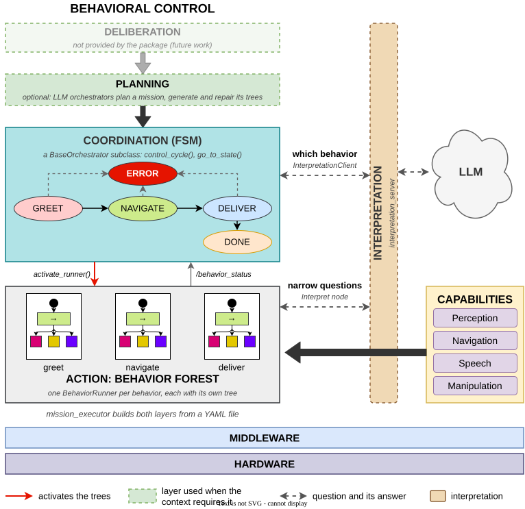

# Architecture

This document describes the design of `behavior_architecture`: how the layers of behavioral
control map onto the code, how the processes and nodes are built and scheduled, how behaviors
are loaded, run and reported, and the design of the two optional components, the LLM
orchestrators and interpretation. The [README](README.md) covers installation and use.

## Contents

- [Layers](#layers)
- [Process structure](#process-structure)
- [Lifecycle](#lifecycle)
- [Control cycle and status reporting](#control-cycle-and-status-reporting)
- [The shared blackboard](#the-shared-blackboard)
- [Behavior runners: trees and plugins](#behavior-runners-trees-and-plugins)
- [Orchestrator types and plugin libraries](#orchestrator-types-and-plugin-libraries)
- [LLM orchestrators](#llm-orchestrators)
- [Interpretation](#interpretation)
- [Source layout](#source-layout)

## Layers



Behavioral control is organized in layers, each with authority over the one below:

| Layer | Responsibility | Implementation in the package |
|---|---|---|
| Deliberation | Which missions to pursue | Not provided. |
| Planning (optional) | A mission as a sequence of steps, each with its tree | `LLMPlanOrchestrator`, `MCPLLMPlanOrchestrator` (types `llm`, `mcp`), with the services of llm_planner and llm_bt_builder. |
| Coordination | Which behavior runs, and when | An FSM in a subclass of `BaseOrchestrator`. |
| Action | How a behavior is carried out | The behavior forest: one `BehaviorRunner` per behavior, each with one behavior tree. |
| Capabilities | Perception, navigation, speech, manipulation... | Outside the package: ROS 2 interfaces used by the BT nodes. |

Planning, when present, replaces a hand-written FSM: an LLM orchestrator is itself a
`BaseOrchestrator` whose FSM requests plans and trees and runs them. Interpretation is not a
layer ([Interpretation](#interpretation)): it is drawn beside the layers that consult it.

## Process structure

`mission_executor` (`src/mission_executor.cpp`) runs a mission in one process:

1. It parses the YAML file (`config_parser.hpp`: `parse_config()`), and fails if
   `orchestrator_type` or, for a non-LLM type, `behaviors` is missing.
2. It loads every library of `orchestrator_libraries` with `dlopen(RTLD_LAZY | RTLD_GLOBAL)`,
   first as `<prefix of package_name>/lib/<file>` and then by file name. Loading a library runs
   its static `OrchestratorRegistrar` objects, which register its types.
3. It creates a `BT::Blackboard`, an `rclcpp::Node` named `node_name`, and stores the node on
   the blackboard under `node`.
4. It writes the configuration to the blackboard (`setup_blackboard_from_config()`):
   `behaviors_config`, `plugin_libraries` and `package_name` for a fixed orchestrator, or the
   `llm_*` keys for an LLM type.
5. It creates the orchestrator with `OrchestratorFactory::create_orchestrator(orchestrator_type,
   blackboard)`, then triggers its `configure` and `activate` transitions.
6. It adds the ROS node, every runner and the orchestrator to a
   `rclcpp::executors::MultiThreadedExecutor` and spins it until shutdown.

Each runner and the orchestrator are separate lifecycle nodes, named after their `name` and
after the name that the orchestrator class passes to `BaseOrchestrator`. Each node has its own
default callback group, so the executor can run the orchestrator's control cycle, the ticks of
the active runner and the callbacks of the ROS node in parallel threads. The callbacks of one
node never run concurrently with each other.

`simple_example` and `restaurant_example` repeat steps 3 to 6 with a fixed orchestrator class
instead of the factory. `llm_plan_executor` and `llm_bt_executor` build their own blackboard
(the first with no keys at all, not even `node`).

## Lifecycle

| Transition | `BaseOrchestrator` | `BehaviorRunner` |
|---|---|---|
| constructor | Declares `control_cycle_rate_ms` (default 100) and reads it; subscribes to `/behavior_status`. | Declares `enable_groot_monitoring` and `groot_port`; creates the lifecycle publisher of `/behavior_status`. |
| `configure` | If no runner was registered, creates one `BehaviorRunner` per entry of `behaviors_config`; then configures every runner. | Default (no work). |
| `activate` | Starts the timer of `control_cycle()`. Activates no runner. | Builds the tree, creates its loggers, activates the publisher and starts the tick timer ([Behavior runners](#behavior-runners-trees-and-plugins)). If the tree cannot be built, the transition fails and the runner stays inactive. |
| `deactivate` | Deactivates the active runners and stops the timer. | Stops the timer, removes the loggers, publishes `DEACTIVATED`, deactivates the publisher, halts the tree. |

The orchestrator drives the runners' transitions directly (`trigger_transition()` on each
runner object), within its own thread: `activate_runner()` returns once the runner has built its
tree, or has failed to, which it returns as `false`. The runners' lifecycle services exist, as for any lifecycle node, but the package does not
use them.

A runner can be activated and deactivated any number of times. Every activation builds a new
tree from the file (or from the XML given with `set_bt()`), so a behavior always starts from its
initial state.

## Control cycle and status reporting

The orchestrator's timer calls `control_cycle()` every `control_cycle_rate_ms`. A typical cycle
checks the state, polls for the end of the active behavior with `check_behavior_finished()` and,
when it ends, chooses the next state with `go_to_state()`. Nothing in the cycle should block: a
long operation (a service call, an interpretation question) is started in one cycle and polled
in the following ones.

The active runner ticks its tree every `control_period_ms` and publishes on `/behavior_status`
(`std_msgs/String`):

| Status | When |
|---|---|
| `RUNNING` | After every tick that returns `RUNNING`. |
| `SUCCESS` | Once, after the tick that returns `SUCCESS`; the runner stops ticking but stays active. |
| `FAILURE` | Once, after a tick that returns `FAILURE` (or any status other than `SUCCESS` and `RUNNING`); the runner stops ticking but stays active. |
| `DEACTIVATED` | When the runner is deactivated. |

The orchestrator keeps the last status received in `last_status_`. `check_behavior_finished()`
compares it with the last status it reported: when the status has changed and is `SUCCESS` or
`FAILURE`, it records it and returns `true`; otherwise it returns `false`. A `DEACTIVATED`
message clears both values, so a behavior activated afterwards is reported even if it ends with
the same result as the previous one, and even if it ends on its first tick without ever
publishing `RUNNING`.

A runner that could not be activated publishes nothing. `activate_runner()` records the failure,
and the next `check_behavior_finished()` returns `true` with `last_status_` set to `FAILURE`, so
that an FSM that waits for the behavior does not wait forever; the next activation clears that
result, as `DEACTIVATED` would. An orchestrator that checks the value of `activate_runner()`, or
the state of the runner, handles the failure at once instead.

The topic is absolute and shared by every runner, and the message does not identify its sender.
The design therefore assumes one active runner at a time: the FSM state names the behavior that
runs, and the status on the topic belongs to it.

## The shared blackboard

One `BT::Blackboard` is shared by the orchestrator and every tree: each runner creates its tree
directly on it, not on a child blackboard. It holds three kinds of entries:

- `node`: the `rclcpp::Node` created by `mission_executor`, which BT nodes use for their
  publishers, subscriptions, clients and timers. The executor spins it, so BT nodes never spin.
- The configuration that `mission_executor` wrote (`behaviors_config`, `plugin_libraries`,
  `package_name`, or the `llm_*` keys).
- The entries that trees and the orchestrator write. An output of a tree remains after its runner
  is deactivated, so data passes from one behavior to the next, and between the FSM and the
  trees, through blackboard keys.

The blackboard protects each entry with its own lock, so the orchestrator's thread and a runner's
thread can access it concurrently. A runner's tree is protected by a mutex of the runner, since
the tree is ticked by the runner's timer and halted from the orchestrator's thread.

## Behavior runners: trees and plugins

`BehaviorRunner` (`behavior_runner.hpp`) is constructed with the blackboard, its name, the path
of its XML file, the list of plugin libraries, the package of the file, the tick period and,
optionally, a function that registers nodes from code. On every activation it:

1. Resolves the file: an absolute path is used as is; a relative path is resolved in the share
   directory of the runner's package (`ament_index_cpp::get_package_share_directory()`).
2. Creates a new `BT::BehaviorTreeFactory`, registers the nodes of each plugin library
   (`registerFromPlugin()`, which loads the library through the dynamic loader) and calls the
   registration function, if any.
3. Builds the tree on the shared blackboard, from the file, or from the XML text given with
   `set_bt()` when there is one (the LLM orchestrators use it for generated trees).
4. Creates a `BT::StdCoutLogger` and, when `enable_groot_monitoring` is true, a
   `BT::Groot2Publisher` on `groot_port` (Groot2 also uses the next port).
5. Starts a wall timer that ticks the tree with `executeTick()` every `control_period_ms`.

An error in these steps (a file or a package that is not found, a library that cannot be loaded,
an unknown node, invalid XML, a tree whose `ID` is the ID of a registered node) fails the
transition: the runner logs `could not build the tree from <file>: <reason>` (for an ID that is
a node ID, the reason names the ID, which BehaviorTree.CPP does not), keeps the reason in
`activation_error()`, and stays inactive, so that it can be activated again, for example after
`set_bt()` with a corrected tree. It publishes no status ([Control cycle and status
reporting](#control-cycle-and-status-reporting)).

## Orchestrator types and plugin libraries

`OrchestratorFactory` (`orchestrator_factory.hpp`) is a process-wide map from a type name to a
function that creates an orchestrator from a blackboard. `OrchestratorRegistrar<T>`, declared as
a static object in the `.cpp` file of an orchestrator, adds `T` to the map when the program or
the library that contains it is loaded. Two kinds of types result:

- Types compiled into `mission_executor`: `simple` and `restaurant` and, when the LLM
  orchestrators are built, `llm`, `mcp`, `mcp_llm` and `mcp_llm_plan_orchestrator`. Run without
  arguments, `mission_executor` lists them.
- Types of an application's library, registered when the configuration loads the library from
  `orchestrator_libraries`. The library is loaded with `RTLD_GLOBAL`, so the BT plugin libraries
  and the orchestrator share the symbols of `libbehavior_architecture`.

The orchestrator thus lives in the application's package, with no `main`, and the framework's
executable stays generic.

## LLM orchestrators

The LLM orchestrators are built only when `llm_planner_interfaces` and `llm_bt_builder` are in
the workspace (`llm.repos`). None of the base classes depends on them.

### Classes

| Class | Type | Base | Purpose |
|---|---|---|---|
| `LLMPlanOrchestrator` | `llm` | `BaseOrchestrator` | Plan a mission, generate one tree per step, run, repair and replan. |
| `MCPLLMPlanOrchestrator` | `mcp` | `LLMPlanOrchestrator` | The same, with mission context and episodic memory on disk. |
| `LLMBTOrchestrator` | `llm_bt` (only in `llm_bt_executor`) | `BaseOrchestrator` | Generate, run and repair one tree for one objective, without planning. |

### LLMPlanOrchestrator

The orchestrator has its own FSM:

```
IDLE -> WAITING_PLAN -> GENERATING_BT -> EXECUTING_BT -> (next step) ... -> SUCCESS
                             ^                 |
                             |                 +-> WAITING_FIX_BT -> EXECUTING_BT
                             |                 +-> WAITING_REPLAN -> GENERATING_BT
                             +--------------------------------------------- FAILED
```

| Interface | Name (relative) | Type |
|---|---|---|
| Service server | `start_mission` | `llm_planner_interfaces/srv/StartMission` |
| Service clients | `plan_task`, `replan_task` | `llm_planner_interfaces/srv/PlanTask`, `ReplanTask` |
| Service clients | `generate_bt`, `fix_bt` | `llm_bt_builder/srv/GenerateBT`, `FixBT` |
| Publisher | `llm_orchestrator/status` | `std_msgs/String` |

A mission is accepted in `IDLE`, `SUCCESS` or `FAILED`, and rejected while another is in
progress. Every service call is asynchronous: the request is sent in one control cycle and its
future is polled in the following ones, as in any orchestrator.

Each step of the plan carries an objective (a YAML block sent to `generate_bt`) and the
blackboard outputs it declares. The orchestrator gives the generated XML to its single runner,
`llm_bt_runner`, with `set_bt()`, activates it and waits for its result, with a limit of
`bt_timeout_sec` per step. A tree that ran successfully is cached in its step and reused when the
plan restarts.

A failing tree reports its cause through the blackboard:

| Key | Written by | Meaning |
|---|---|---|
| `bt_last_failure` | a BT node | A readable cause of the failure. |
| `bt_last_failure_code` | a BT node | A code: `bt_config_error` marks a local error of the tree; `FORCED_FAILURE` asks for the plan to be restarted. |
| `fail_message` | a BT node | Text appended to the cause of a `FORCED_FAILURE`. |

The orchestrator reads and clears those keys after every step and decides:

| Outcome | Decision |
|---|---|
| `SUCCESS` | Next step; `GOAL_SUCCESS` after the last one. |
| `FAILURE` whose cause contains `NO_REAL_FAILURE` | The failure is accepted and the next step runs. |
| `FORCED_FAILURE` (also after a `SUCCESS`) | The step's cached tree is discarded; the plan restarts from its first step (`restart_after_forced: true`) or is replanned. |
| Local error (`bt_config_error`, or a cause that mentions the XML, its syntax, a missing port or the node configuration) | The tree is repaired with `fix_bt`, up to 3 times per step. |
| Any other failure, a step timeout or a failed generation | A new plan is requested with `replan_task`, up to 3 times per mission, if `replan_active` is true; otherwise the mission fails. |

With `save_exec`, each mission is saved under `<exec_dir>/<mission_name>/<timestamp>/`:
`plan/plan.yaml` and `plan/step_<NN>.xml` for the first plan, `replan_<n>/` for each replan, and
`metrics.csv` with the planning, generation and execution times and the repairs of each step.

The class exposes virtual hooks for derived orchestrators: `handle_start_mission()`,
`request_plan()`, `request_replan()`, `request_generate_bt()`, `request_fix_bt()`,
`collect_failure_reason()` and `transition_to()`. A derived class overrides a hook, calls the
base implementation and adds its own work.

### MCPLLMPlanOrchestrator

`MCPLLMPlanOrchestrator` overrides those hooks to keep the context of the mission on disk, in
`llm_mcp_context_dir` (default `<exec_dir>/mcp_context`):

```
mission_snapshot.json
failure_history.json
plan__success_episodic_memory.json
plan_failure_episodic_memory.json
bt_success_episodic_memory.json
bt_failure_episodic_memory.json
```

### LLMBTOrchestrator

`LLMBTOrchestrator` isolates tree generation from planning, for evaluation. Its FSM is
`IDLE -> GENERATING_BT -> EXECUTING_BT -> SUCCESS | FAILED`, with `WAITING_FIX_BT` between a
failed execution and the next attempt, up to `llm_max_bt_regenerations` repairs. It uses only
`generate_bt` and `fix_bt`, publishes on `llm_bt_orchestrator/status`, and writes per-attempt and
per-run metrics and, optionally, an episodic memory of at most 200 success and 200 failure cases.
`llm_bt_executor` fills its blackboard from the command line; the workflow and the metrics are
described in [BT_GENERATION_EVAL.md](BT_GENERATION_EVAL.md).

### Blackboard keys of the LLM orchestrators

| Key | Default | Used by |
|---|---|---|
| `llm_plugin_libraries` | `["libsocial_bt_nodes_plugin.so"]` | all |
| `llm_bt_nodes_packages` | `[]` | all (capabilities from `<pkg>/node_descriptions/<pkg>.yaml`) |
| `llm_capabilities_yaml` | `""` | all; replaces `llm_bt_nodes_packages` |
| `llm_control_period_ms` | `50` | all |
| `llm_timeout_sec` | `30.0` | all |
| `llm_save_exec` | `false` (plan), `true` (`llm_bt_executor`) | all |
| `llm_exec_dir` | `exec` (plan), `exec/bt_generation_eval` (`llm_bt_executor`) | all |
| `llm_mission_name` | `""` | `LLMPlanOrchestrator`; alias of `llm_task_name` in `LLMBTOrchestrator` |
| `llm_skills` | `[]` | `LLMPlanOrchestrator` |
| `llm_replan_active` | `true` | `LLMPlanOrchestrator` |
| `llm_restart_after_forced` | `true` | `LLMPlanOrchestrator` |
| `llm_mcp_context_dir` | `<llm_exec_dir>/mcp_context` | `MCPLLMPlanOrchestrator` |
| `llm_task_name`, `llm_objective_path`, `llm_useful_info`, `llm_blackboard_seed_path` | | `LLMBTOrchestrator` |
| `llm_fail_on_missing_inputs` | `false` | `LLMBTOrchestrator` |
| `llm_shutdown_on_completion` | `true` | `LLMBTOrchestrator` |
| `llm_use_episodic_memory` | `false` | `LLMBTOrchestrator` |
| `llm_max_bt_regenerations` | `3` | `LLMBTOrchestrator` |

`mission_executor` fills the keys of the plan orchestrators from the YAML file
([README](README.md#llm-orchestrators-optional)); `llm_bt_executor` fills those of
`LLMBTOrchestrator` from its command line.

### Extending them

A new orchestrator derived from `LLMPlanOrchestrator` overrides the hooks above, registers
itself with `OrchestratorRegistrar`, and is built in the application's package, linked to
`llm_planner_interfaces` and `llm_bt_builder`. The LLM orchestrators are compiled into the
executables of this package and are not exported as a library, so the derived class needs their
sources; inside this package, the file is added to the `if(WITH_LLM_ORCHESTRATORS)` blocks of
`CMakeLists.txt`.

## Interpretation

### Why it is beside the layers

The layers form a chain of control: each one decides what the one below does. Interpretation
does not decide anything. It turns what arrives without structure (a request in natural
language, a sentence, a camera image) into a validated answer to a narrow question that a layer
asks: which behavior fits a request, which values of a form a sentence gives, which detection is
the target. The layer that asks decides what to do with the answer. Interpretation is not a
capability either: it has no coordination, no actions and no goal interface of its own.

It is therefore drawn as a column beside the layers that consult it, optional, with a model
behind it that is external and replaceable. Two properties form its contract:

- **No state.** Everything a question needs travels with it. A fact that later questions reuse
  (for example a distinctive feature of a tracked person) is kept by the tree or the
  orchestrator, on the blackboard, and passed again. Every question can be logged, replayed and
  tested on its own.
- **No control.** Interpretation never activates, stops or sequences anything, and never decides
  an outcome. It answers; the asker decides.

### What is generic and what is not

The machinery of asking a model is generic and lives in the package; the questions belong to
each system:

| In `behavior_architecture` | In each system |
|---|---|
| The query interface: a named question, its context, optional images, a time budget; a validated answer, whether a fallback was used and why | The questions: their templates, answer fields, validation and fallbacks |
| The server: prompt from a template, structured output, tolerant parsing, validation, retries, per-call limit and budget, fallback, logging and replay | What a system does with an answer |
| Model backends behind one abstraction | Which model answers which question (configuration) |
| Choosing a behavior from a catalog, rejecting an id that was not offered | Filtering the catalog before asking |
| A client for orchestrators and BT nodes for trees, both non-blocking | The FSMs and trees that ask |
| Rules that take the model's place | Which rules exist |

Interpretation is a service that the framework provides and launches, not a base class that
each system implements. A system configures it (its questions in YAML, its templates and, for
questions with logic of their own, a Python module that the server loads) and asks it.

### Components

| Component | Language | Location |
|---|---|---|
| `Interpret.srv` | ROS 2 interface | `srv/` |
| `interpretation_server` | Python | `behavior_interpretation/node.py` (ROS wrapper) and `server.py` (no ROS dependency) |
| Questions, fields, templates, validation | Python | `behavior_interpretation/questions.py`, `fields.py`, `templates.py`, `validation.py` |
| Interpreters | Python | `behavior_interpretation/interpreters/` (`rule.py`, `llm/`) |
| Backends | Python | `behavior_interpretation/interpreters/llm/backends/` |
| Call log | Python | `behavior_interpretation/call_log.py` |
| `InterpretationClient` | C++ | `include/behavior_architecture/interpretation/`, `src/interpretation/` |
| `Interpret`, `InterpretationResult` | C++ (BT plugin) | `src/interpretation/interpret_bt_nodes.cpp` |

The Python package is `behavior_interpretation`, not `behavior_architecture`, because the
generated Python module of the interface is already `behavior_architecture`
(`behavior_architecture.srv`).

### One call

The server answers each request independently, and concurrently with others:

1. Look up the question and its variant (the request's, else the server's configuration), and
   apply the launch-time override of its interpreters.
2. Parse the context (a JSON object), resolve the answer's fields (declared, or taken from the
   context) and the images (none, required or optional; at most `max_images`).
3. Try the question's chain of interpreters in order. An interpreter *answers*, *declines* (the
   call does not apply to it; the next one is tried) or *fails* (no valid answer; the chain
   ends).
4. Without an answer, use the question's fallback (source `fallback`) or return no answer
   (source `invalid`), with the reason: `timeout`, `invalid`, `model_down`, `budget` or
   `declined`.
5. Write the call to the log.

`success` is false only when the request cannot be taken (an unknown question or variant, a
context that is not a JSON object, too many or too few images). An answer that the model could
not give is a successful call with source `invalid`, which the asker can distinguish from a valid
answer such as `-1` ("none of the offered behaviors").

### Interpreters and chains

An interpreter implements `answer(question, call, option)` and returns an outcome. The server
hosts two:

- `llm`: builds the prompt from the question's template (or its class's `build_prompt()`), calls
  the backend of the question's route with the schema of the answer and the images, parses the
  text tolerantly (a reasoning block, a code fence or text around the JSON object are accepted),
  validates it and retries a failed or invalid answer up to `max_retries`. It never declines.
- `rule`: calls deterministic code registered by a question module. A rule returns an answer or
  `None` to decline, so that a chain such as `[rule, llm]` answers with the rule when it applies
  and with the model otherwise.

The chain of a question is part of its definition and can be replaced at launch
(`interpreter_overrides`) or by a variant, without editing the question; this supports
ablations and fallbacks to rules. The source of the answer names the interpreter that gave it.
Adding an interpreter (for example a world model) is a subclass of `Interpreter` registered in
the server (`InterpretationServer(interpreters=...)` in Python); neither the service nor the
callers change.

Every answer, from a model or from a rule, is validated in the same way: every declared field
present and of its type (a value of the wrong JSON type but readable as the right one, such as
the string `"3"` for an integer, is converted), the value of the choice field among the choices
taken from the context, and the question class's `validate()`.

### Limits and budget

Each attempt of the `llm` interpreter is limited by the route's `timeout_s` (default 120 s) and
by what remains of the request's `budget_s` (0: no budget). When the budget is spent the call
fails with the reason `budget`. The client has its own limit (default 120 s), which only protects
the asker from a server that does not answer.

### Backends and routes

A *route* names a backend, a model and the backend's options; each question names a route, so
different questions can use different models. A backend implements
`generate(model, prompt, schema, images, limits) -> text` and translates the schema into its
API's form (Ollama `format`, OpenAI `response_format`, Gemini `responseSchema`). Temperature is 0
by default. Images are encoded once, losslessly, as PNG without resizing; the default dialect of
the `gemini` backend sends them as JPEG at quality 95 instead.

Each HTTP backend has two dialects, `llm_router` (default) and `llm_manager`, which reproduce the
requests of two existing LLM gateways (`llm_router` and `ros2_llm_manager`): the same body,
schema and image bytes for the same call, so that a system that moves to interpretation sends a
model the same request as before. The dialects differ in streaming, token caps, reasoning
options and system prompts ([docs/INTERPRETATION.md](docs/INTERPRETATION.md#dialects)).

### Namespaces

Each system launches its own server, configured only at launch, in its own namespace. The
service name is relative (`interpretation/interpret`), and the client and the BT nodes resolve
it in the namespace of their node, so two systems on one robot (for example
`/attention/interpretation/interpret` and `/interaction/interpretation/interpret`) ask their own
servers. A request carries only what belongs to that call.

### The client

`InterpretationClient` is owned by an orchestrator, by composition, rather than inherited: an
orchestrator that does not ask questions does not change. It accepts any node type
(`rclcpp::Node`, `rclcpp_lifecycle::LifecycleNode`, or a pointer to either) through the node
interfaces. `ask()` returns a handle at once; the handle sends the request as soon as the service
is available and is polled from `control_cycle()` without waiting. A handle fails, without
blocking, when the service does not appear or does not answer within the client's timeout.
`choose_behavior()` is the generic part of choosing a behavior: it adds the offered behaviors to
the context (`offered_behaviors`, `offered_ids`) so that the system's own question and template
can use them, and `behavior_choice()` rejects an id that was not offered.

### The BT nodes

`Interpret` asks from a tree. With `wait="true"` it is `RUNNING` until the answer arrives, so the
tree keeps ticking; with `wait="false"` it returns `SUCCESS` at once and leaves the question in
progress on the blackboard, where `InterpretationResult` picks the answer up later. This covers
questions whose answer is needed only by a later node. The default output keys are prefixed
`interpretation_`.

### Logging and replay

Every call is written as one JSON line: the question, the request, the prompt, the schema, the
images (saved once, by hash), every attempt with its raw answer, the answer, its source, the
fallback reason, the latency, the tokens and the model version. The `recorded` backend answers
from such logs by question and prompt, attempt by attempt, which makes a system's behavior
reproducible without a model and allows two implementations to be compared decision by
decision.

### Opt-in linking

Generating an interface makes rosidl add its libraries, targets, include directories and
dependencies to the package's default CMake variables, so every package that finds
`behavior_architecture` would link the interface's typesupport libraries, and the client if it
were exported the same way. Since interpretation is not part of the base, the package keeps it
out of those variables:

- The base's exports are declared before the interface, so that the default variables are
  computed as without interpretation.
- What `rosidl_generate_interfaces()` adds to the export lists is moved out of them, and the
  export sets of the interface and of the client are installed by the package itself.
- The package config file saves the default variables right after the config files of the
  base's exports (`cmake/default_variables_snapshot-extras.cmake`) and restores them in its last
  config file (`cmake/default_variables-extras.cmake.in`), so that nothing that rosidl's config
  files add to them, in any version of rosidl, reaches a package that does not opt in.
- `cmake/interpretation-extras.cmake.in` defines the imported targets and the variables
  `behavior_architecture_INTERPRETATION_TARGETS`, `..._INTERPRETATION_INTERFACE_TARGETS` and
  `..._INTERPRETATION_FOUND`; `cmake/interpretation_dependencies-extras.cmake.in` finds the
  dependencies of interpretation after the default variables are computed.

The interface is generated as the CMake target `behavior_architecture_interfaces`, since
`behavior_architecture` is the base library's target; its libraries are given the file names
that the typesupport dispatch expects for the package (`libbehavior_architecture__rosidl_*.so`).
A package that does not name interpretation gets the same link line as without it;
`test/check_consumer_variables.sh` prints the variables that such a package receives and compares
them with those of a build without interpretation. The BT nodes' library is loaded by name and is
not exported.

The design record, with the requirements that shaped it, is
[docs/INTERPRETATION_DESIGN.md](docs/INTERPRETATION_DESIGN.md).

## Source layout

```
behavior_architecture/
├── include/behavior_architecture/
│   ├── base_orchestrator.hpp, behavior_runner.hpp, orchestrator_factory.hpp
│   ├── behavior_config.hpp, config_parser.hpp     the YAML configuration
│   ├── llm_plan_orchestrator.hpp, mcp_llm_plan_orchestrator.hpp, llm_bt_orchestrator.hpp
│   ├── test_plan_orchestrator.hpp, yaml_utils.hpp
│   ├── examples/                                   simple and restaurant orchestrators
│   └── interpretation/                             InterpretationClient, BT nodes
├── src/
│   ├── behavior_architecture/                      the base library
│   ├── examples/                                   example orchestrators and their main
│   ├── interpretation/                             client and BT nodes
│   └── mission_executor.cpp, start_mission.cpp, llm_*.cpp, test_plan_*.cpp, static_tf_publisher.cpp
├── behavior_interpretation/                        the interpretation server (Python)
├── srv/Interpret.srv
├── behaviors/                                      shipped trees (reusable/, examples/)
├── config/                                         example configurations; interpretation/
├── launch/
├── cmake/                                          opt-in export of interpretation
├── scripts/interpretation_server
├── test/base/, test/interpretation/
└── docs/
```
