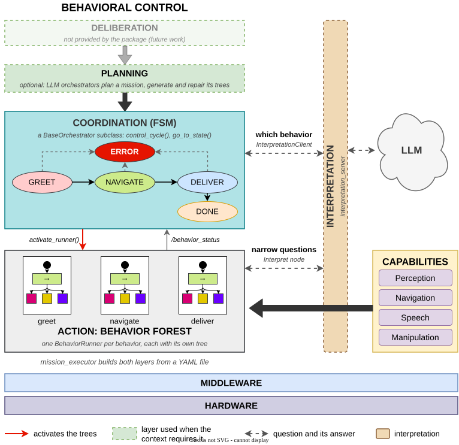

# behavior_architecture

`behavior_architecture` is a ROS 2 framework for the behavioral control of a robot. A finite
state machine (FSM), the *orchestrator*, decides which behavior runs; each behavior is a
BehaviorTree.CPP tree executed by its own *behavior runner*. A generic executable,
`mission_executor`, builds the orchestrator and its runners from a YAML file, so that an
application provides an orchestrator, its trees and a configuration, and no `main`.

Two optional components extend the base: LLM orchestrators that plan a mission and generate
and repair its trees with a language model, and *interpretation*, a service that answers the
narrow questions that an orchestrator or a tree asks about unstructured input (natural
language, images).

| ROS 2 distribution | Branch |
|---|---|
| Jazzy | `main` |
| Lyrical | `lyrical` ([differences](#ros-2-lyrical)) |

License: Apache-2.0.

## Contents

- [How it works](#how-it-works)
- [Installation](#installation)
- [Quick start](#quick-start)
- [Mission configuration](#mission-configuration)
- [Writing an orchestrator](#writing-an-orchestrator)
- [Writing behaviors](#writing-behaviors)
- [LLM orchestrators (optional)](#llm-orchestrators-optional)
- [Interpretation (optional)](#interpretation-optional)
- [Executables and launch files](#executables-and-launch-files)
- [ROS 2 Lyrical](#ros-2-lyrical)
- [Testing](#testing)
- [Troubleshooting](#troubleshooting)
- [Used by](#used-by)
- [Further documentation](#further-documentation)
- [License](#license)

## How it works



The figure shows the layers of behavioral control, from deliberation down to the hardware, and
the element of the package that implements each of them. Each layer has authority over the one
below it. The figure is an editable draw.io file
([docs/media/behavior_architecture_layers.drawio.svg](docs/media/behavior_architecture_layers.drawio.svg)).

**Deliberation** decides which missions to pursue. The package does not provide it.

**Planning** turns a mission into a sequence of steps. It is optional: the LLM orchestrators
(types `llm` and `mcp`) ask a planner service for a plan, ask a tree builder service for one
tree per step, run the trees, and repair or replan on failure
([LLM orchestrators](#llm-orchestrators-optional)).

**Coordination** is an FSM implemented by a subclass of `BaseOrchestrator`, a ROS 2 lifecycle
node. Its `control_cycle()` runs periodically and decides, from the result of the behavior that
ran and from any other input, which behavior runs next; `go_to_state()` activates and deactivates
the behavior runners of each state.

**Action** is the *behavior forest*: one `BehaviorRunner` (a lifecycle node) per behavior, each
with its own behavior tree. A runner builds its tree when it is activated, ticks it periodically
and reports `RUNNING`, `SUCCESS`, `FAILURE` or `DEACTIVATED` on the topic `/behavior_status`.

**Capabilities** are the robot's skills (perception, navigation, speech, manipulation). They
are outside the package; the BT nodes of the trees reach them through ROS 2 topics, services and
actions.

**Interpretation** is beside the layers, not one of them. An orchestrator (through
`InterpretationClient`) or a tree (through the BT node `Interpret`) asks the
`interpretation_server` a narrow question, such as which behavior fits a request or which values
a sentence gives, and receives a validated answer. Interpretation keeps no state and commands
nothing; the layer that asks decides what to do with the answer
([Interpretation](#interpretation-optional)).

`mission_executor` builds the coordination and action layers from a YAML file: it loads the
libraries that register orchestrator types, creates the orchestrator named in the file, which
creates one runner per behavior, and spins all of them. [ARCHITECTURE.md](ARCHITECTURE.md)
describes the design in depth.

## Installation

The package is built from source with colcon. The table lists what each part requires.

| Part | Provides | Source dependencies |
|---|---|---|
| Base | `libbehavior_architecture` (`BaseOrchestrator`, `BehaviorRunner`, `OrchestratorFactory`), `mission_executor` with the example types `simple` and `restaurant`, `simple_example`, `restaurant_example`, `test_plan_executor`, `static_tf_publisher` | none (`thirdparty.repos` is empty) |
| Interpretation | the service `Interpret`, `interpretation_server`, `libbehavior_architecture_interpretation` (`InterpretationClient`) and the BT nodes `Interpret` and `InterpretationResult`; always built with the base, linked only by the packages that ask for it | none |
| LLM orchestrators | types `llm` and `mcp` in `mission_executor`; `llm_plan_executor`, `llm_bt_executor`, `start_mission` | `llm.repos`: [llm_bt_builder](https://github.com/rodperex/llm_bt_builder), [llm_planner](https://github.com/rodperex/llm_planner) |
| Example BT nodes | the nodes used by `config/simple_config.yaml`, `config/restaurant_config.yaml` and `behaviors/reusable/follow_behavior.xml` | `examples.repos`: [social_bt_nodes](https://github.com/rodperex/social_bt_nodes) |

Every other dependency (rclcpp, rclcpp_lifecycle, behaviortree_cpp, yaml-cpp, nlohmann-json,
sensor_msgs, tf2_ros, rclpy) is a ROS 2 binary package that rosdep installs.

### Base

```bash
source /opt/ros/jazzy/setup.bash          # or /opt/ros/lyrical/setup.bash
mkdir -p ~/ws/src && cd ~/ws/src
git clone https://github.com/geriabot/behavior_architecture.git    # Lyrical: add -b lyrical
cd ~/ws
rosdep install --from-paths src --ignore-src -y \
  --skip-keys "llm_planner_interfaces llm_bt_builder"
colcon build --symlink-install
source install/setup.bash
```

`package.xml` declares `llm_planner_interfaces` and `llm_bt_builder` so that colcon builds them
first when they are in the workspace. CMake does not require them, and rosdep cannot resolve
them, hence `--skip-keys`.

Run without arguments, `mission_executor` prints its usage and the orchestrator types compiled
into it (`restaurant` and `simple` for the base):

```bash
ros2 run behavior_architecture mission_executor
```

### LLM orchestrators

```bash
cd ~/ws
vcs import src < src/behavior_architecture/llm.repos
rosdep install --from-paths src --ignore-src -y
colcon build --symlink-install
```

CMake reports which variant it builds:

```
-- behavior_architecture: building the LLM orchestrators (llm, mcp, llm_bt)
-- behavior_architecture: llm_planner_interfaces or llm_bt_builder not found: the LLM orchestrators ...
```

When the two packages are added to a workspace that has already built the base, rebuild with
`colcon build --cmake-clean-cache` (or remove `build/behavior_architecture`) so that CMake looks
for them again. `mission_executor` then also lists `llm`, `mcp`, `mcp_llm` and
`mcp_llm_plan_orchestrator`.

### Example BT nodes

```bash
cd ~/ws
vcs import src < src/behavior_architecture/examples.repos
rosdep install --from-paths src --ignore-src -y
colcon build --symlink-install
```

social_bt_nodes has dependencies of its own; see its repository.

### Interpretation

Interpretation needs nothing beyond the base. Two backends have optional runtime dependencies:
the `gemini` backend needs OpenCV for Python (`python3-opencv`) and numpy to send images, and the
`llama_ros` backend needs [llama_ros](https://github.com/mgonzs13/llama_ros) and its action
server.

## Quick start

### A mission with the base only

The following mission runs two trees made of BehaviorTree.CPP built-in nodes with the example
orchestrator `simple`, which runs the runner `state1_runner`, then `state2_runner`, retrying a
runner whose tree fails, and stops. It needs no BT plugin library and no robot.

```bash
source ~/ws/install/setup.bash
mkdir -p ~/ba_quickstart && cd ~/ba_quickstart

cat > greet.xml <<'EOF'
<root BTCPP_format="4">
  <BehaviorTree ID="Greet">
    <Sequence>
      <Script code="greeting := 'hello'"/>
      <Sleep msec="1000"/>
    </Sequence>
  </BehaviorTree>
</root>
EOF

cat > farewell.xml <<'EOF'
<root BTCPP_format="4">
  <BehaviorTree ID="Farewell">
    <Sleep msec="500"/>
  </BehaviorTree>
</root>
EOF

# Unquoted delimiter: the shell writes the absolute paths of the trees
cat > mission.yaml <<EOF
orchestrator_type: "simple"
plugin_libraries: []
behaviors:
  - name: "state1_runner"
    behavior_file: "$PWD/greet.xml"
  - name: "state2_runner"
    behavior_file: "$PWD/farewell.xml"
EOF

ros2 run behavior_architecture mission_executor mission.yaml
```

The log shows the orchestrator entering `STATE_1`, the runner `state1_runner` building its tree
and reporting `RUNNING` and then `SUCCESS`, the same for `state2_runner`, and finally
`State: STOP - All behaviors completed`. The process keeps spinning until it is interrupted with
Ctrl-C.

### The shipped examples

With the example BT nodes built, the two shipped configurations run with:

```bash
ros2 launch behavior_architecture mission_executor_simple.launch.py
ros2 launch behavior_architecture mission_executor_restaurant.launch.py
```

`simple` runs `behaviors/examples/state1.xml` and `state2.xml`, whose `Speak` nodes call the
service `/tts_service`. `restaurant` runs `behaviors/reusable/follow_behavior.xml` (the TF frames
`target` and `base_link`, the topics `/target`, `/sensors/sonar` and `/sensors/touch`) and then
`behaviors/examples/collect_order.xml` (the services `/tts_service`, `/stt_service`,
`/yesno_service` and `/extract_service`). A robot or a simulator must provide those interfaces.

Any configuration runs with either of:

```bash
ros2 launch behavior_architecture mission_executor.launch.py config_file:=/path/to/mission.yaml
ros2 run behavior_architecture mission_executor /path/to/mission.yaml
```

## Mission configuration

A configuration for an orchestrator written by the application (every type except the LLM
types):

```yaml
node_name: "my_robot_bt_node"           # the ROS node that the BT nodes use
orchestrator_type: "my_orchestrator"    # a registered type (required)
package_name: "my_robot"                # default package of the behavior files and libraries
orchestrator_libraries:                 # shared libraries that register orchestrator types
  - "libmy_robot_orchestrator.so"
plugin_libraries:                       # BehaviorTree.CPP plugin libraries, for every runner
  - "libmy_robot_bt_nodes.so"
behaviors:                              # one behavior runner each (required)
  - name: "greet"                       # runner (and node) name, used by activate_runner()
    behavior_file: "behaviors/greet.xml"
    control_period_ms: 50
  - name: "follow"
    behavior_file: "behaviors/reusable/follow_behavior.xml"
    package_name: "behavior_architecture"   # this file comes from another package
```

| Key | Default | Meaning |
|---|---|---|
| `orchestrator_type` | required | A type registered with `OrchestratorRegistrar`. The aliases `mcp_llm` and `mcp_llm_plan_orchestrator` are read as `mcp`. |
| `node_name` | `bt_node` | Name of the `rclcpp::Node` that `mission_executor` creates and stores on the blackboard under the key `node`. |
| `package_name` | `behavior_architecture` | Package whose share directory resolves relative `behavior_file` paths, and whose install prefix holds the `orchestrator_libraries`. |
| `orchestrator_libraries` | `[]` | Libraries loaded with `dlopen` before the orchestrator is created. Each is looked up as `<prefix of package_name>/lib/<file>`, then by file name through the dynamic loader (`LD_LIBRARY_PATH`). |
| `plugin_libraries` | `[]` | BehaviorTree.CPP plugin libraries (`BT_REGISTER_NODES`) that every runner loads. BehaviorTree.CPP loads each by the given name or path through the dynamic loader; a sourced workspace puts the `lib/` directory of each package on `LD_LIBRARY_PATH`. |
| `behaviors` | required | The behavior runners. |
| `behaviors[].name` | required | Name of the runner, which is also its ROS node name. |
| `behaviors[].behavior_file` | required | Tree XML file: an absolute path, or a path relative to the share directory of the behavior's package. |
| `behaviors[].package_name` | the global `package_name` | Package of this behavior's file. |
| `behaviors[].control_period_ms` | `50` | Tick period of the runner. |

`mission_executor` writes `behaviors_config`, `plugin_libraries` and `package_name` to the
blackboard, from which `BaseOrchestrator::on_configure()` creates the runners. The keys of the
LLM types are listed in [LLM orchestrators](#llm-orchestrators-optional); `bt_nodes_packages`,
present in the example configurations, is used only by them.

The trees shipped with the package (`behaviors/reusable/`) can be used from any package by
setting `package_name: "behavior_architecture"` on the entry; see
[behaviors/README.md](behaviors/README.md).

### Node parameters

| Node | Parameter | Default | Meaning |
|---|---|---|---|
| orchestrator | `control_cycle_rate_ms` | `100` | Period of `control_cycle()`, read when the orchestrator is constructed. The LLM orchestrators use `bt_control_period_ms` instead. |
| each runner | `enable_groot_monitoring` | `true` | Publish the tree to Groot2 while the runner is active. |
| each runner | `groot_port` | `5555` | Groot2 port; the next port is also used. Runners active at the same time need different ports. |

The nodes run in the `mission_executor` process, so their parameters are given in a parameters
file keyed by node name. The orchestrator's node name is the one its class passes to the
`BaseOrchestrator` constructor (`simple_orchestrator` for `simple`); a runner's is its `name` in
the YAML:

```yaml
# params.yaml
simple_orchestrator:
  ros__parameters:
    control_cycle_rate_ms: 50
state1_runner:
  ros__parameters:
    enable_groot_monitoring: false
```

```bash
ros2 run behavior_architecture mission_executor mission.yaml --ros-args --params-file params.yaml
```

## Writing an orchestrator

An orchestrator is a subclass of `behavior_architecture::BaseOrchestrator` in a shared library of
the application's package. `mission_executor` loads the library (`orchestrator_libraries`), and a
static `OrchestratorRegistrar` in the library registers the type under a name
(`orchestrator_type`).

```cpp
#include "behavior_architecture/base_orchestrator.hpp"
#include "behavior_architecture/orchestrator_factory.hpp"

namespace my_robot
{

class MyOrchestrator : public behavior_architecture::BaseOrchestrator
{
public:
  explicit MyOrchestrator(BT::Blackboard::Ptr blackboard)
  : BaseOrchestrator("my_orchestrator", blackboard) {}

protected:
  enum State {INIT, GREET, FOLLOW, DONE};

  void control_cycle() override
  {
    switch (state_) {
      case INIT:
        go_to_state(GREET);
        break;
      case GREET:
        if (check_behavior_finished()) {
          go_to_state(last_status_ == "SUCCESS" ? FOLLOW : DONE);
        }
        break;
      case FOLLOW:
        if (check_behavior_finished()) {
          go_to_state(DONE);
        }
        break;
      case DONE:
        break;
    }
  }

  void go_to_state(int state) override
  {
    state_ = static_cast<State>(state);
    deactivate_all_runners();
    if (state_ == GREET) {activate_runner("greet");}
    if (state_ == FOLLOW) {activate_runner("follow");}
  }

private:
  State state_ {INIT};
};

// Registers the type "my_orchestrator" when the library is loaded
static behavior_architecture::OrchestratorRegistrar<MyOrchestrator> registrar("my_orchestrator");

}  // namespace my_robot
```

The constructor takes only a `BT::Blackboard::Ptr`: the factory creates the orchestrator with
the blackboard that `mission_executor` filled.

### BaseOrchestrator API

| Member | Kind | Description |
|---|---|---|
| `control_cycle()` | pure virtual | The FSM. Called every `control_cycle_rate_ms` while the orchestrator is active. |
| `go_to_state(int)` | pure virtual | Enter a state: activate and deactivate the runners it needs. |
| `activate_runner(name)` | protected | Activate the runner: it builds its tree and starts ticking. Returns `false`, and logs why, if no runner has that name or the runner cannot build its tree. |
| `deactivate_runner(name)` | protected | Deactivate the runner: its tree is halted. |
| `deactivate_all_runners()` | protected | Deactivate every runner activated through this class. |
| `check_behavior_finished()` | protected | `true` once when the status received on `/behavior_status` changes to `SUCCESS` or `FAILURE`, or after an `activate_runner()` that failed (as `FAILURE`); that status is then in `last_status_`. |
| `last_status_` | protected | The last status received (`""`, `RUNNING`, `SUCCESS` or `FAILURE`; `DEACTIVATED` resets it to `""`). |
| `blackboard_` | protected | The blackboard shared with every tree. |
| `runners_` | protected | The runners, by name. |
| `register_runner(name, runner)` | public | Add a runner created in code. Call it before the orchestrator is configured; a YAML behavior of the same name then uses this runner. |
| `get_runners()` | public | The runners, which `mission_executor` adds to its executor. |
| `on_configure()`, `on_activate()`, `on_deactivate()` | lifecycle | May be overridden; an override calls the base implementation. |

`on_configure()` creates one runner per entry of `behaviors` whose `name` has no runner yet, and
configures every runner. A runner registered with `register_runner()` before is kept, and the
YAML entry of the same name, if any, uses it (the log says so): an orchestrator can create in
code the runners that need it, for example to register nodes from code, and leave the others to
the YAML. `on_activate()` starts the control cycle; `on_deactivate()` deactivates every runner
and stops it.

A runner that cannot build its tree (a file or a package that is not found, a plugin library
that cannot be loaded, a node that is not registered, invalid XML, a tree whose `ID` is a node
ID) does not activate: the runner logs the reason, `activate_runner()` returns `false`, and
`check_behavior_finished()` then reports the behavior as finished with `FAILURE`. The runner
stays inactive and can be activated again.

Every runner publishes on the same topic, and the status does not identify the runner that sent
it, so an orchestrator keeps one runner active at a time. Concurrent activities belong in one
tree (a `Parallel` node, or subtrees).

### Building and loading the library

```cmake
cmake_minimum_required(VERSION 3.10)
project(my_robot)

find_package(ament_cmake REQUIRED)
find_package(ament_index_cpp REQUIRED)
find_package(rclcpp REQUIRED)
find_package(rclcpp_lifecycle REQUIRED)
find_package(std_msgs REQUIRED)
find_package(behaviortree_cpp REQUIRED)
find_package(behavior_architecture REQUIRED)

add_library(${PROJECT_NAME}_orchestrator SHARED src/my_orchestrator.cpp)
target_include_directories(${PROJECT_NAME}_orchestrator PUBLIC
  $<BUILD_INTERFACE:${CMAKE_CURRENT_SOURCE_DIR}/include>
  ${behavior_architecture_INCLUDE_DIRS})
target_link_libraries(${PROJECT_NAME}_orchestrator
  ${behavior_architecture_LIBRARIES}
  rclcpp::rclcpp
  rclcpp_lifecycle::rclcpp_lifecycle
  behaviortree_cpp::behaviortree_cpp
  ament_index_cpp::ament_index_cpp
  ${std_msgs_TARGETS})

install(TARGETS ${PROJECT_NAME}_orchestrator LIBRARY DESTINATION lib)
ament_package()
```

This form links targets and builds on Jazzy and on Lyrical. The library is installed to `lib/`
of the package, and the configuration names it:

```yaml
package_name: "my_robot"
orchestrator_libraries: ["libmy_robot_orchestrator.so"]
orchestrator_type: "my_orchestrator"
```

`mission_executor` without arguments does not list a type loaded from `orchestrator_libraries`:
the type is registered only when a configuration loads its library. The log of a run shows
`Registered orchestrator type: my_orchestrator` and
`Loaded orchestrator library: libmy_robot_orchestrator.so`.

[docs/CUSTOM_ORCHESTRATORS.md](docs/CUSTOM_ORCHESTRATORS.md) builds a complete package step by
step: orchestrator, BT plugin library, trees, configuration and launch file. The example
orchestrators are in `src/examples/`.

## Writing behaviors

A behavior is a BehaviorTree.CPP v4 XML file (`BTCPP_format="4"`). Its nodes are the built-in
nodes of BehaviorTree.CPP and the nodes of the plugin libraries listed in `plugin_libraries`.

A plugin library registers its nodes with `BT_REGISTER_NODES` and is compiled with
`BT_PLUGIN_EXPORT` defined:

```cpp
#include "behaviortree_cpp/bt_factory.h"
#include "my_robot/bt_nodes/greet.hpp"

BT_REGISTER_NODES(factory)
{
  factory.registerNodeType<my_robot::Greet>("Greet");
}
```

A BT node that needs ROS takes the node that `mission_executor` created from the blackboard. The
node is spun by the executor of `mission_executor`, so a BT node does not spin it:

```cpp
node_ = config().blackboard->get<rclcpp::Node::SharedPtr>("node");
```

Every tree is created on the same blackboard as the orchestrator. A value that a tree writes
(an output port mapped to `{key}`) remains on the blackboard after the runner is deactivated, so
the next behavior, or the orchestrator, can read it. The orchestrator can also write inputs for a
tree before activating its runner.

The `ID` of a `<BehaviorTree>` must differ from the IDs of the registered nodes: a tree `Greet`
that uses a node `Greet` fails to build, and the runner's error names the tree file and the ID.

## LLM orchestrators (optional)

Built only with `llm.repos` ([Installation](#llm-orchestrators)).

| Type or executable | Class | What it does |
|---|---|---|
| `llm` | `LLMPlanOrchestrator` | Waits for a mission on its `start_mission` service, requests a plan (`plan_task`), generates one tree per step (`generate_bt`), runs each tree in the runner `llm_bt_runner`, repairs a tree that fails with a local error (`fix_bt`) and replans otherwise (`replan_task`). |
| `mcp` (aliases `mcp_llm`, `mcp_llm_plan_orchestrator`) | `MCPLLMPlanOrchestrator` | `llm`, plus mission snapshots, failure history and episodic memory written to disk. |
| `llm_plan_executor` | `LLMPlanOrchestrator` | The `llm` orchestrator with an empty blackboard (built-in defaults), without a configuration file. |
| `llm_bt_executor` | `LLMBTOrchestrator` | Generates, runs and repairs one tree for an objective file, without planning; used to evaluate tree generation ([BT_GENERATION_EVAL.md](BT_GENERATION_EVAL.md)). |
| `start_mission` | | Sends the `goal` of a mission file to the `start_mission` service. |

A configuration for the LLM types has no `behaviors`:

| Key | Default | Meaning |
|---|---|---|
| `plugin_libraries` | `[]` | BT plugin libraries of the generated trees. |
| `bt_nodes_packages` (or `bt_nodes_package`) | `[]` | Packages whose `share/<pkg>/node_descriptions/<pkg>.yaml` describe the available BT nodes to the tree builder. |
| `bt_control_period_ms` | `50` | Period of the control cycle and of the runner. |
| `bt_timeout_sec` | `30.0` | Longest execution of one step's tree. |
| `skills` | `[]` | Capabilities of the robot, sent with every plan request; a mission may replace them. |
| `save_exec` | `false` | Save plans, trees and metrics under `<exec_dir>/<mission_name>/<timestamp>/`. |
| `exec_dir` | `exec` | Base directory of the saved executions. |
| `mission_name` | `""` | Name of the mission in the saved paths; a mission may replace it. |
| `replan_active` | `true` | Request a new plan after a failure that a repair cannot fix; `false` ends the mission instead. |
| `restart_after_forced` | `true` | After a tree reports `FORCED_FAILURE`, restart the plan from its first step (`true`) or replan (`false`). |

After the configuration file, `mission_executor` accepts `--save-exec`, `--exec-dir PATH` and
`--replan-active true|false`, which override the corresponding keys.

`config/llm_config.yaml` is a complete configuration. It also holds the keys that
`launch/llm_dummy_demo.launch.py` passes to the planner and tree builder nodes
(`planner_llm_provider`, `planner_llm_model`, `planner_llm_api_key`, `bt_builder_llm_provider`,
`bt_builder_llm_model`, `bt_builder_llm_api_key`) and the mission (`goal`, `context`). It uses the
BT nodes of [dummy_bt_nodes](https://github.com/rodperex/dummy_bt_nodes), which must be cloned
into the workspace.

```bash
# The planner and the tree builder too (launch_llm_nodes:=false when they already run)
ros2 launch behavior_architecture llm_dummy_demo.launch.py launch_llm_nodes:=true
```

The launch file starts `mission_executor` with the configuration and, after 3 s,
`start_mission`, which sends the mission of the same file (`mission_file`) with the skills of
`skills_file`. A mission is sent to a running orchestrator with:

```bash
ros2 run behavior_architecture start_mission --ros-args \
  -p mission_file:=$(ros2 pkg prefix behavior_architecture)/share/behavior_architecture/config/llm_config.yaml \
  -p skills_file:=$(ros2 pkg prefix behavior_architecture)/share/behavior_architecture/config/skills.yaml
```

A mission file has `goal` (required) and optionally `context`, `useful_info`, `preconditions`,
`postconditions` and `skills`; `skills_file`, when given, replaces `skills`. The orchestrator
publishes its progress (`GOAL_SUCCESS`, `STEP_<n>_SUCCESS`, `STEP_<n>_FAILED`,
`FAILED_NO_MORE_REPLANS`...) on `llm_orchestrator/status`. The design of these orchestrators is
in [ARCHITECTURE.md](ARCHITECTURE.md#llm-orchestrators).

## Interpretation (optional)

*Interpretation* turns unstructured input (a request in natural language, a sentence said by a
person, a camera image) into a validated answer to a narrow question that a layer asks: which
behavior fits this request, which values of a form this sentence gives, which of these
detections is the target. It commands nothing: the orchestrator or the tree that asks decides
what to do with the answer. It keeps no state between questions, so every question can be
logged, replayed and tested on its own.

[docs/INTERPRETATION.md](docs/INTERPRETATION.md) is the user guide and complete reference, with
a worked example. In summary:

| Part | What it is |
|---|---|
| `srv/Interpret.srv` | The request: `question`, `request_id`, `context` (a JSON object), `text`, `images`, `budget_s` (0: no budget), `variant`. The response: `success`, `answer` (a JSON object), `source` (the interpreter that answered, `fallback` or `invalid`), `fallback_reason`, `message`. |
| `interpretation_server` | The server (Python package `behavior_interpretation`). Each question names a chain of *interpreters*: `llm` (a model, through a *route* that names a *backend*: `ollama`, `openai`, `gemini`, `llama_ros`, `fake`, `recorded`) and `rule` (deterministic code). Every call can be written to a call log, which the `recorded` backend replays. |
| `InterpretationClient` | A non-blocking C++ client that an orchestrator owns (`libbehavior_architecture_interpretation`). |
| `Interpret`, `InterpretationResult` | BT nodes (`libbehavior_architecture_interpretation_bt_nodes.so`) that ask without blocking the tree. |
| `launch/interpretation.launch.py` | Launches a server with its parameters file, in a namespace. |

### Launching a server

Each system launches its own server, configured at launch. The service name is relative
(`interpretation/interpret`): the server, the client and the BT nodes resolve it in the
namespace of their node.

```bash
# The example: two questions answered by the fake backend, without any model server
ros2 launch behavior_architecture interpretation.launch.py

# A server of your own
ros2 launch behavior_architecture interpretation.launch.py params_file:=/path/to/params.yaml

# With mission_executor (interpretation is false by default)
ros2 launch behavior_architecture mission_executor.launch.py config_file:=/path/to/mission.yaml \
  interpretation:=true interpretation_params_file:=/path/to/params.yaml
```

### Declaring questions

```yaml
# questions.yaml (server parameter questions_file)
questions:
  choose_behavior:
    template: choose_behavior            # a key of the templates file
    fields: ["int:behavior_id"]          # the answer: int, str, float, bool or arrays (int[])
    choices_from: context.offered_ids    # the answer must be one of these, or -1
    interpreter: llm                     # or rule, or a chain such as [rule, llm]
    route: text                          # the backend and model that answer
```

```yaml
# templates.yaml (server parameter templates_file): {key of the context}, {text}, {output_format}
templates:
  choose_behavior: "A robot was asked: {text}\nBehaviors:\n{offered_behaviors}\n{output_format}"
```

```yaml
# params.yaml (launch argument params_file)
/**/interpretation_server:
  ros__parameters:
    questions_file: package://my_robot/config/questions.yaml
    templates_file: package://my_robot/config/templates.yaml
    default_route: text
    routes:
      text: {backend: ollama, model: "qwen2.5vl:7b", url: "http://localhost:11434"}
    log_dir: /tmp/interpretation          # "" writes no log
```

### Asking from an orchestrator

```cpp
#include "behavior_architecture/interpretation/interpretation_client.hpp"

using behavior_architecture::interpretation::InterpretationClient;
using behavior_architecture::interpretation::InterpretationHandle;
using behavior_architecture::interpretation::OfferedBehavior;

// Members of the orchestrator
std::unique_ptr<InterpretationClient> client_;
InterpretationHandle handle_;
std::vector<OfferedBehavior> offered_ {
  {1, "greet", "Greet the person"}, {2, "follow", "Follow the person"}};

// Once, for example in the constructor: the client uses the orchestrator's node
client_ = std::make_unique<InterpretationClient>(this);

// Ask; the call returns at once
handle_ = client_->choose_behavior("choose_behavior", offered_, "{}", request_text);

// In control_cycle(): poll without blocking
if (handle_.ready()) {
  auto choice = InterpretationClient::behavior_choice(handle_.result(), offered_);
  // choice.id is an offered id, or -1 with choice.reason
}
```

### Asking from a tree

Add `libbehavior_architecture_interpretation_bt_nodes.so` to `plugin_libraries`. The nodes use
the ROS node stored on the blackboard under `node`.

```xml
<!-- Wait for the answer (the node is RUNNING meanwhile; the tree is not blocked) -->
<Interpret question="extract_slots" context="{slots_context}" text="{heard}"
           answer="{slots}" source="{slots_source}"/>

<!-- Ask now, pick the answer up later -->
<Interpret question="choose_behavior" context="{choose_context}" text="{heard}" wait="false"/>
<InterpretationResult question="choose_behavior" answer="{choice}"/>
```

`context` is a JSON object, written in the attribute or read from the blackboard (`{key}`), and
`context_keys` adds blackboard entries to it by name. Written in the attribute, the object is
enclosed in single quotes, so that its double quotes need no escaping:

```xml
<Interpret question="extract_slots" context='{"slots": ["str:name", "int:age"]}'
           context_keys="heard_before, offered_ids=ids" text="{heard}" answer="{slots}"/>
```

### Linking interpretation

`find_package(behavior_architecture)` sets the default variables (`_LIBRARIES`, `_INCLUDE_DIRS`,
`_TARGETS`, `_DEPENDENCIES`) to the base library alone, so a package that does not use
interpretation links nothing of it. A package that uses it names it:

```cmake
find_package(behavior_architecture REQUIRED)
# InterpretationClient, with the generated interface and its dependencies
target_link_libraries(my_orchestrator behavior_architecture::interpretation)
```

The BT nodes are not linked; their library is loaded by name from `plugin_libraries`. From
Python, the interface is `from behavior_architecture.srv import Interpret`. The other variables
are listed in [docs/INTERPRETATION.md](docs/INTERPRETATION.md#linking).

### Logging and replay

With `log_dir` set, the server appends one JSON line per call to `<log_dir>/calls.jsonl` (the
question, the context, the prompt, the schema, every attempt and its raw answer, the answer, its
source, latency and tokens) and saves each image once as `<log_dir>/images/<sha256>.png`. A route
with `backend: recorded` and `log_files: [<log_dir>/calls.jsonl]` answers every call from the
log, by question and prompt, so that a run is reproduced without a model.

## Executables and launch files

| Executable | Part | Usage |
|---|---|---|
| `mission_executor` | base | `mission_executor <config.yaml> [--save-exec] [--exec-dir PATH] [--replan-active true\|false]` ([Mission configuration](#mission-configuration)). |
| `simple_example`, `restaurant_example` | base | The example orchestrators with a `main` of their own: `simple_example [config.yaml]`, `restaurant_example [config.yaml]` (default: the installed `config/simple_config.yaml` or `config/restaurant_config.yaml`). `mission_executor` supersedes them. |
| `test_plan_executor` | base | `test_plan_executor <directory> [plugin_library ...]`: a development tool that runs the XML trees of a directory, in file-name order, in one runner, until one fails; the BT plugin libraries default to `libsocial_bt_nodes_plugin.so`. |
| `static_tf_publisher` | base | Publishes the static transforms of a YAML file (parameter `tf_file`; key `static_transforms`, each entry with `base_frame` (default `map`), `child_frame`, `x`, `y`, `z`, `yaw`). |
| `interpretation_server` | interpretation | The interpretation server ([docs/INTERPRETATION.md](docs/INTERPRETATION.md#server-parameters)). |
| `llm_plan_executor` | LLM | The `llm` orchestrator with built-in defaults. |
| `llm_bt_executor` | LLM | `llm_bt_executor --objective <file> [options]` ([BT_GENERATION_EVAL.md](BT_GENERATION_EVAL.md)); `--help` lists the options. |
| `start_mission` | LLM | Parameters `mission_file` (required; `goal_file` is accepted as its former name) and `skills_file`. |

| Launch file | Arguments (default) | Runs |
|---|---|---|
| `mission_executor.launch.py` | `config_file` (`config/restaurant_config.yaml`), `interpretation` (`false`), `interpretation_params_file` (`config/interpretation/example_params.yaml`), `interpretation_namespace` (`""`) | `mission_executor` and, with `interpretation:=true`, an interpretation server |
| `interpretation.launch.py` | `namespace` (`""`), `params_file` (`config/interpretation/example_params.yaml`), `questions_file`, `templates_file`, `log_dir` (each `""`: taken from `params_file`) | `interpretation_server` |
| `mission_executor_simple.launch.py`, `mission_executor_restaurant.launch.py` | none | `mission_executor` with `config/simple_config.yaml` or `config/restaurant_config.yaml` (need `examples.repos`) |
| `simple_example.launch.py`, `restaurant_example.launch.py` | none | `simple_example`, `restaurant_example` |
| `test.launch.py` | `plan_dir` (`exec/test_plan`, relative to the working directory) | `test_plan_executor` |
| `llm_dummy_demo.launch.py` | `config_file` (`config/llm_config.yaml`), `skills_file` (`config/skills.yaml`), `launch_llm_nodes` (`false`), `save_exec` (`false`), `replan_active` (`true`) | the planner and tree builder (optional), `mission_executor`, `start_mission` (needs `llm.repos` and dummy_bt_nodes) |
| `llm_bt_eval.launch.py` | see [BT_GENERATION_EVAL.md](BT_GENERATION_EVAL.md) | `llm_bt_executor` and `static_tf_publisher` (needs `llm.repos` and dummy_bt_nodes) |

## ROS 2 Lyrical

Branch `lyrical` builds on ROS 2 Lyrical and on Jazzy. It differs from `main` in two places:

- `ament_target_dependencies()`, which the ament_cmake of Lyrical no longer provides, is replaced
  by a CMake function, `link_ament_dependencies()`, that links the targets exported by each
  dependency.
- The LLM orchestrators read the future of `async_send_request()` with `.future.share()`, since
  Lyrical returns a `FutureAndRequestId`.

The C++ API, the configuration files, the executables and the launch files are the same on both
branches. The interpretation targets use only `target_link_libraries()` and `.future.share()`, so
they build unchanged on both. A package that uses `behavior_architecture` on Lyrical links it
with `target_link_libraries()`, as in
[Building and loading the library](#building-and-loading-the-library).

## Testing

```bash
cd ~/ws
colcon build --packages-select behavior_architecture
colcon test --packages-select behavior_architecture \
  --ctest-args -R "interpretation|test_base_orchestrator|test_episodic_memory_files|test_test_plan_executor"
colcon test-result --verbose
```

| Test | What it checks |
|---|---|
| `test_base_orchestrator` (gtest) | `BehaviorRunner` and `BaseOrchestrator`: a tree that cannot be built (a tree ID that is a node ID, a missing file, an unknown node) fails the activation with its reason and is reported as `FAILURE`; the runners of the YAML and those registered in code. |
| `test_episodic_memory_files` (gtest) | The files of the episodic memory, and the former name of the plan memory. |
| `test_test_plan_executor` (pytest) | `test_plan_executor` runs the trees of a directory in order, and stops at one that fails or cannot be built. |
| `test_interpretation_server` (pytest) | The server with the `fake` and `recorded` backends: questions, fields, validation, chains, budgets, fallbacks, images, backend requests, the call log and its replay; the process ends with code 0 on Ctrl-C. No model is contacted. |
| `test_interpretation_client` (gtest) | `InterpretationClient` against a fake server node: non-blocking calls, namespaces, timeouts, cancellation, `choose_behavior`. |
| `test_interpretation_bt_nodes` (gtest) | `Interpret` and `InterpretationResult`, loaded as a plugin, with a context written in the XML or taken from blackboard entries. |

Without `-R`, `colcon test` also runs the linters of `ament_lint_auto`. When
ament_cmake_ros is available, the tests that create ROS nodes run isolated from the other ROS
processes of the computer.

`test/check_consumer_variables.sh` checks that interpretation stays opt-in: with the install
sourced, it prints the CMake variables that a package receives from
`find_package(behavior_architecture)`, and with `-c BASELINE` compares them with the output of the
same script for a build without interpretation.

## Troubleshooting

**`Failed to create orchestrator. Available types: ...`.** `orchestrator_type` does not match
the name given to `OrchestratorRegistrar`, or the library that registers it is missing from
`orchestrator_libraries`. The registrar must be at namespace scope in a `.cpp` file of the
library.

**`Failed to load orchestrator library`.** The library is not installed to `lib/` of
`package_name`, the workspace is not sourced, or the library has undefined symbols (the
`dlerror()` text names them). `ldd -r install/my_robot/lib/libmy_robot_orchestrator.so` lists
them.

**`BehaviorRunner (...) could not build the tree from ...`.** The runner failed to activate, for
the reason that the message gives: the tree file or its package was not found, a plugin library
could not be loaded, a node of the tree is not registered, the XML is invalid, or the tree's `ID`
equals a node ID (the message names the ID). The orchestrator logs
`Runner '...' could not be activated`, and `check_behavior_finished()` reports `FAILURE`; an
orchestrator that retries a failed behavior (as `simple` does) retries it, and fails again,
until the tree is corrected.

**`Runner '...' not registered`.** The name passed to `activate_runner()` is not a `name` of the
YAML `behaviors`.

**The orchestrator misses or confuses results.** Several runners are active at once; they share
`/behavior_status`. Keep one active runner per state.

**`Groot2 monitoring unavailable on port 5555`.** Another process, or another active runner,
uses the port. Set `groot_port` per runner, or `enable_groot_monitoring: false`
([Node parameters](#node-parameters)).

**A behavior file is not found.** A relative `behavior_file` is resolved in the share directory
of the behavior's `package_name` (or the global one); the package must install its `behaviors/`
directory there.

**Interpretation: `the service /.../interpretation/interpret is not available`.** No server runs
in the namespace of the asking node. A server launched with `interpretation_namespace:=ns` serves
`/ns/interpretation/interpret`, while the nodes of `mission_executor` run in the root namespace.
Run both in the same namespace, or give the absolute service name (BT port `service`, or the
`service_name` argument of `InterpretationClient`). More cases are in
[docs/INTERPRETATION.md](docs/INTERPRETATION.md#troubleshooting).

## Used by

- [attention_system](https://github.com/geriabot/attention_system): attention for a social robot.
- [interaction_system](https://github.com/geriabot/interaction_system): task-bounded dialogue for
  social robots. Its orchestrator is a plugin loaded through `orchestrator_libraries`, and it
  needs only the base.
- [dummy_robot](https://github.com/geriabot/dummy_robot): a minimal package with an orchestrator
  and BT nodes of its own.

## Further documentation

| Document | Contents |
|---|---|
| [ARCHITECTURE.md](ARCHITECTURE.md) | The design: lifecycle, control cycle, blackboard, runners, status, the LLM orchestrators and interpretation. |
| [docs/CUSTOM_ORCHESTRATORS.md](docs/CUSTOM_ORCHESTRATORS.md) | A package with an orchestrator, BT nodes, trees and a launch file, step by step. |
| [docs/INTERPRETATION.md](docs/INTERPRETATION.md) | Interpretation: user guide, parameter and question-file reference, worked example. |
| [docs/INTERPRETATION_DESIGN.md](docs/INTERPRETATION_DESIGN.md) | The design record of interpretation. |
| [behaviors/README.md](behaviors/README.md) | The trees shipped with the package. |
| [docs/USING_REUSABLE_BEHAVIORS.md](docs/USING_REUSABLE_BEHAVIORS.md) | Using those trees from another package. |
| [docs/ADDING_REUSABLE_BEHAVIORS.md](docs/ADDING_REUSABLE_BEHAVIORS.md) | Adding a tree to the catalogue. |
| [BT_GENERATION_EVAL.md](BT_GENERATION_EVAL.md) | Evaluating LLM tree generation with `llm_bt_executor`. |

## License

Apache License 2.0; see [LICENSE](LICENSE).
